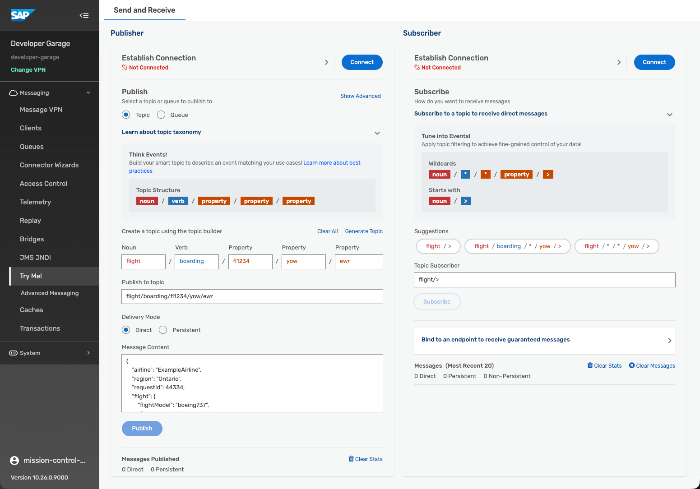

# Teched2026 Developer Garage: Publish and Subscribe to Events in SAP Integration Suite, Advanced Event Mesh

**Duration:** ~30 minutes | **Level:** Beginner

Get started with your first message exchange by using the UI in SAP Integration Suite, Advanced Event Mesh (AEM), and explore a different section through which you can exchange messages.

---

## Description

SAP Integration Suite, advanced event mesh is SAP's flagship event broker. 

Actually, it is more than just that: it allows you to create meshes of event brokers and to use powerful eventing platform, operations and event management features. Explore these powerful features of SAP Integration Suite, advanced event mesh. 

This short Developer Garage tutorial will start with the core event-driven architecture elements like queues and topics. 
To dive deeper into the topic you can join our TechEd2026 hands-on session [IN163: Build your own event-driven scenario with advanced event mesh](https://www.sap.com/events/teched/berlin/flow/sap/te26/catalog/page/catalog/session/1786029069284001qBM4).

## Prerequisites

- Access to an SAP Integration Suite, Advanced Event Mesh tenant

In order to log into Advanced Event Mesh, you can use the below mentioned link and test user:

| Resource | Data |
|----------|-------|
| AEM console| https://url.sap/y3fiys |
| Login User| **DevGarageAEM** |

The password will be provided to you by the moderators.

## What You Will Learn

- Access AEM and find do your first steps
- What topics are and how they work in AEM
- How to send and receive messages via the **Try Me!** page in the event broker service
- The difference between Direct and Persistent message delivery modes

## Exercises

| Exercise | Topic |
|----------|-------|
| [Introduction - What is SAP Integration Suite, advanced event mesh](exercises/ex0/README.md) | SAP Integration Suite, advanced event mesh is SAP's flagship event broker. |
| [Exercise 1 - Explore SAP Integration Suite, advanced event mesh](exercises/ex1/README.md) | Get a first hands-on impression and an overview of AEM |
| [Exercise 2 - Topic Hierarchies](exercises/ex2/README.md) | Understand topic structure, levels, and wildcards. Send and receive messages using the Try Me! page |
| [Exercise 3 – Persistent and Non-Persistent Quality of Service](exercises/ex3/README.md) | Learned about delivery modes, persistency and quality of service. |

## Further Study

| Resource | Link |
|----------|------|
| SAP Developers tutorials | [link](https://developers.sap.com/tutorials/mission-get-started-with-sap-integration-suite-advanced-event-mesh/) |
| Message Delivery Modes | [link](https://help.pubsub.em.services.cloud.sap/Get-Started/message-delivery-modes.htm) |
| Direct Messaging | [link](https://docs.solace.com/Messaging/Direct-Msg/Direct-Messages.htm) |
| Guaranteed Messaging | [link](https://docs.solace.com/Messaging/Guaranteed-Msg/Guaranteed-Messages.htm) |
| Wildcard Characters in Topic Subscriptions | [link](https://help.pubsub.em.services.cloud.sap/Messaging/Wildcard-Charaters-Topic-Subs.htm) |
| AEM Blog Post Collection | [link](https://community.sap.com/t5/technology-blog-posts-by-sap/sap-integration-suite-advanced-event-mesh-blog-collection/ba-p/14111943) |
| Discovery Center Mission: Get started with AEM | [link](https://discovery-center.cloud.sap/missiondetail/4582/4870/) |
| Devtoberfest 2024: Discover SAP Event Sources for Advanced Event Mesh | [link](https://www.youtube.com/watch?v=NujHueCBDOw) |
| Devtoberfest 2025: Hands-on session: practival demonstration of the Event Add-On for ERP | [link](https://www.youtube.com/watch?v=vwzqNLISvHo) |
| Devtoberfest 2026: IntegrAItion - Event-Driven Intelligence | [link](https://www.youtube.com/watch?v=aUNHb-4qyDo) |
| Devtoberfest 2026: Event Add-On for ERP - All you need to know about the new Event Studio | [link](https://www.youtube.com/watch?v=HyLYUZ7bcII) |
| SAP Help | [link](https://help.pubsub.em.services.cloud.sap/Cloud/cloud-lp.htm) |
| SAP Discovery Center - AEM | [link](://discovery-center.cloud.sap/serviceCatalog/advanced-event-mesh?region=all) |

## How to obtain support

Support for the content in this repository is available during the actual time of the online session for which this content has been designed. Otherwise, you may request support via the [Issues](../../issues) tab.

## License

Copyright 2026 SAP SE or an SAP affiliate company and <your-project> contributors. Please see our [LICENSE](LICENSE) for copyright and license information. Detailed information including third-party components and their licensing/copyright information is available [via the REUSE tool](https://api.reuse.software/info/github.com/SAP/<your-project>).

---
[ Start with Introduction →](exercises/ex0/README.md)
