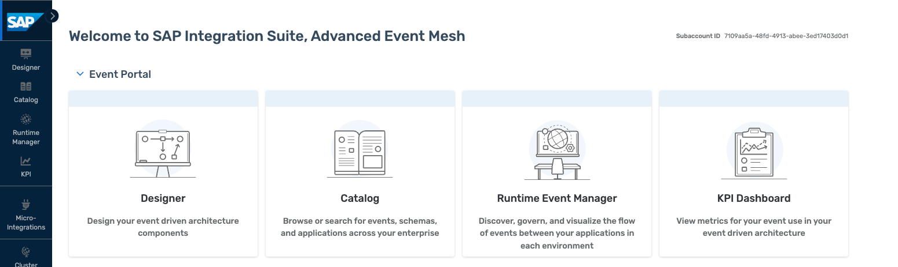

# Introduction - What is SAP Integration Suite, advanced event mesh

[← Back to Overview](../../README.md) | [Next Exercise →](../ex1/README.md)

---

---

SAP Integration Suite, advanced event mesh is a fully managed event streaming and management service that enables enterprise-wide and enterprise-grade event-driven architecture. It is a full blown, general purpose event mesh. AEM offers enterprise-grade performance, reliability, security and governance. It scales to very large use cases – and very means very very very in this case.

- Advanced Event Mesh is a distributed mesh of event brokers that can be deployed across environments, both in the cloud and on-premise
- It offers a full purpose set of eventing services covering all relevant use cases
- AEM supports event streaming, event management and event monitoring
- Brokers fully scale as required and come in different broker sizes to perfectly fit different needs

SAP Integration Suite, advanced event mesh

- is a general purpose, multi-site EDA platform and portal
- allows for SAP to SAP, SAP to Everything and Everything to Everything scenarios
- supports distributed networks of event brokers deployed in different clouds and on-premises
- can be deployed in your cloud of choice or in your on premises K8S
- provides sophisticated authentication and security features like Kerberos, OAuth or TLS
- offers fine-grained filtering options
- allows for real-time monitoring, capacity insights and distributed tracing
- provides support for all relevant protocols like JMS, REST, AMQP and MQTT, plus SMF.
- allows to start small and upgrade to bigger T-shirt sizes when your business grows
- provides an outstanding performance up to billions of events per day

SAP Integration Suite, advanced event mesh features touched, some just shortly, some in more detail, include:

- SAP Integration Suite, advanced event mesh queues
- SAP Integration Suite, advanced event mesh Cluster Manager
- SAP Integration Suite, advanced event mesh Mesh Manager
- SAP Integration Suite, advanced event mesh Event Designer and Event Management
- SAP Integration Suite, advanced event mesh Try Me! tool
- SAP Integration Suite, advanced event mesh Event Portal

---

[← Back to Overview](../../README.md) | [Next Exercise →](../ex1/README.md)