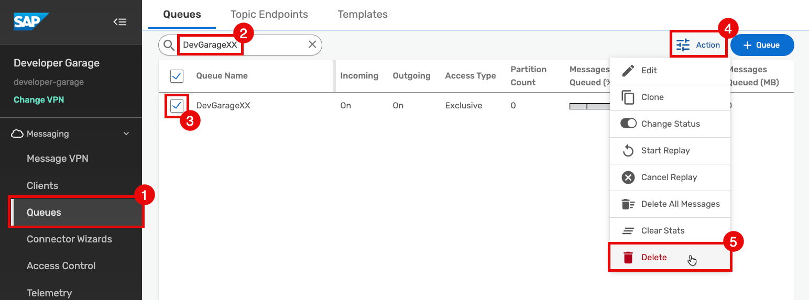

# Exercise 4 – Cleanup

[← Exercise 3](../ex3/README.md) | [Back to Overview →](../../README.md) 

---

---

## Help us to clean up the system, so every user has the same smooth experience.

Please delete all the artifacts that you have created during this tutorial. If you followed all the steps, this should be just the `queue` that you have created, but maybe you played around a little more and added further artifacts. 

1. Click on `Queues`
2. Search for your own queue
3. Select your own `queue`from the list
4. Click the `Àction` button
5. Select `Delete` from the list to delete your queue and all the currently stored messages
6. Repeat for any other artifacts you might have created

## Have fun at TechEd 2026 in Berlin! Enjoy your sessions!

To dive deeper into the topic you can join our TechEd2026 hands-on session: 
- [IN163: Build your own event-driven scenario with advanced event mesh](https://www.sap.com/events/teched/berlin/flow/sap/te26/catalog/page/catalog/session/1786029069284001qBM4).

---

[← Exercise 3](../ex3/README.md) | [Back to Overview →](../../README.md)  